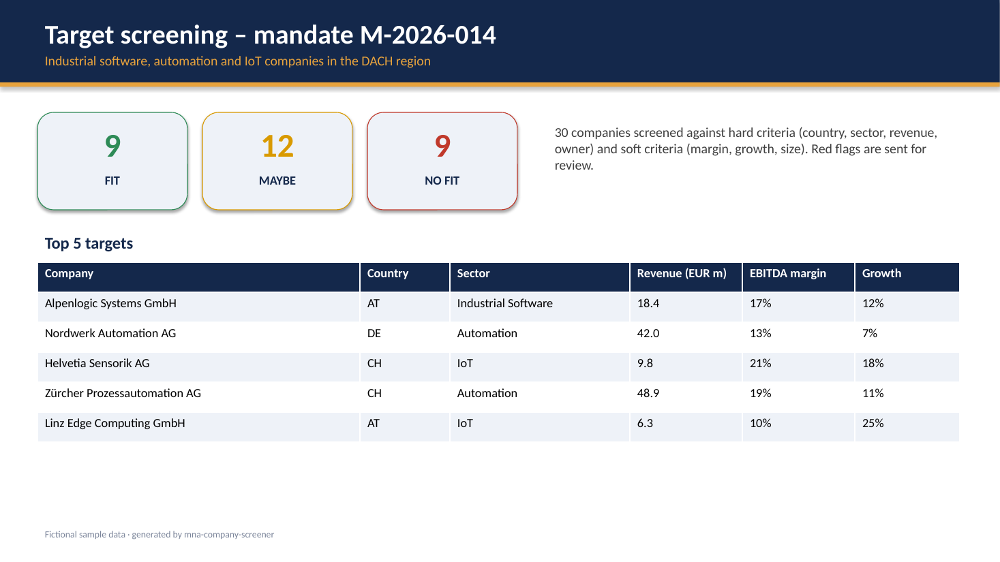

# M&A Company Screener


Screens a long list of potential acquisition targets against a buyer mandate and sorts every company into
**fit / maybe / no_fit** with a written rationale. **Version 2** adds RAG: the tool reads each company's website,
retrieves the passages that matter (litigation, sanctions, restructuring, customer concentration) and gives
them to the LLM as evidence it must cite. The results go to a formatted **Excel** file and a
one-slide **PowerPoint** summary, so the deal team gets them in a usable form.

> All companies and numbers in `data/` are **fictional sample data**.



## Why

In sell-side and buy-side M&A, analysts often screen hundreds of companies by hand. Most decisions follow
clear rules (country, sector, size, margin), but a few need judgement (litigation, sanctions, a finished
restructuring). This tool automates the clear part, explains each decision, sends the judgement cases to
an LLM for a second opinion and measures quality against analyst labels.

## How it works

```
companies.csv ─┐                         websites/*.html ─> clean text ─> chunks ─> BM25 index
mandate.json ──┼─> 1. Rule engine ──> 2. Retrieval (RAG) for "maybe" ──> 3. LLM review with evidence ──> 4. Evaluation ──> Excel + PowerPoint + CSV
eval_labels ───┘     hard / soft /        top passages per risk question      must cite chunk ids,          screening accuracy +
                     red-flag checks      (litigation, sanctions, ...)        validated, safe fallback      retrieval hit@k / MRR
```

1. **Rule engine** (`screener/rules.py`)
   - Hard criteria: country, sector, revenue range, excluded owner types → any miss = `no_fit`
   - Soft criteria: EBITDA margin, revenue growth, headcount → 0 misses = `fit`, 1 = `maybe`, 2+ = `no_fit`
   - Borderline values (within 10% of a threshold) are capped at `maybe`, not rejected
   - Red-flag keywords (litigation, sanctions, insolvency, …) → sent for review
2. **LLM review** (`screener/llm.py`), optional: only `maybe` cases go to the Anthropic Messages API
   through plain `requests`. The model must answer in JSON (`label`, `rationale`, `confidence`), and the
   reply is validated. If there is no API key or the call fails, the rule result stays.
3. **Evaluation** (`screener/evaluate.py`): accuracy, confusion matrix and a list of disagreements against
   30 analyst labels. "Dangerous errors" (analyst says `no_fit`, tool says `fit`) are tracked separately.
4. **Retrieval / RAG** (`screener/web.py`, `screener/rag.py`): each website is cleaned (menus, scripts and
   footers removed), split into one chunk per paragraph with an id like `C008#5`, and indexed with **BM25**
   (keyword ranking, fully offline). For every `maybe` company, four screening questions (litigation, sanctions,
   restructuring, customer concentration) retrieve the top passages. These go into the LLM prompt, and the LLM
   must cite the chunk ids it used; **answers with invented or missing citations are rejected**.
5. **Retrieval evaluation** (`screener/evaluate_rag.py`): 12 analyst-written questions with the text the correct
   passage must contain → **hit@1, hit@3, MRR**.
6. **Exports**: `screening_results.xlsx` (Summary, Screening, Mandate sheets, colour-coded labels, filters),
   `screening_summary.pptx` (KPI boxes + top targets in a fixed style), `screening_results.csv`.

## Results on the sample data

**Screening** (30 companies vs analyst labels)

| Setup | Accuracy | Dangerous errors |
|---|---|---|
| Rules only | **90.0%** (27 / 30) | **0** |
| Rules + evidence-based review of `maybe` cases (simulated LLM in tests) | 100% | 0 |

The 3 rule-only disagreements are judgement cases: active patent litigation, a sanctions review and a
restructuring that is already finished. The facts for all three are only on the company websites, which is
why the retrieval step matters.

**Retrieval** (12 questions)

| Version | hit@1 | hit@3 | MRR |
|---|---|---|---|
| BM25 baseline | 67% | 75% | 0.71 |
| + light stemming + domain synonyms (after error analysis) | **83%** | **92%** | **0.88** |

Remaining misses ("Who owns the company?", "What does the company sell?") need meaning, not keywords:
the next step is an embedding retriever behind the same interface.

## Run it

```bash
pip install -r requirements.txt
python -m screener                     # rules only, writes to output/
export ANTHROPIC_API_KEY=...           # optional
python -m screener --llm               # rules + LLM review of "maybe" cases
python -m pytest -q                    # 25 tests
python scripts/make_sample_websites.py # rebuild the fictional websites
```

Options: `--companies`, `--mandate`, `--labels`, `--out`. Model via `SCREENER_MODEL`.

## Project structure

```
screener/
  rules.py         rule engine with rationales
  llm.py           LLM second opinion (REST + JSON, validated, safe fallback)
  evaluate.py      accuracy, confusion matrix, error list
  export_excel.py  Excel deliverable (openpyxl)
  export_pptx.py   PowerPoint slide (python-pptx)
  io.py            input loading + validation
  web.py           website loading (file or URL) + HTML cleaning
  rag.py           chunking, BM25 index, query expansion, evidence per company
  evaluate_rag.py  retrieval metrics: hit@k, MRR
data/              mandate, 30 fictional companies + websites, analyst labels, retrieval test set
scripts/           generator for the fictional websites
tests/             25 pytest tests, LLM mocked (no network needed)
output/            sample outputs
```

## Next steps

- Embedding retriever (hybrid with BM25) for meaning-based questions
- Evaluation set for the LLM answers themselves, tracked per prompt and model version
- Read company lists directly from Excel files and data providers
- Small internal web app (Streamlit) with login for the deal team

---
Built by **Abdelhamid Moltazim** · [moltazimdata.com](https://moltazimdata.com) · [GitHub](https://github.com/Moltazim-Data)
